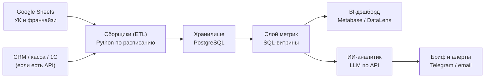

# Дэшборд CEO «НеШкола Барабанов»: вопросы, ликбез, инструкция, бюджет

Версия: 1.0 · Дата: 2026-10-13 · Статус: черновик до ответов на вопросы

Все цены ниже проверены на 13.10.2026. Цены SaaS меняются часто, перед оплатой сверяйте их по ссылкам из раздела «Источники».

---

## 0. Краткий вывод

1. **Главный архитектурный принцип: агенты на LLM не должны «таскать» цифры.** Сбор и расчёт метрик делает детерминированный код (Python + SQL). ИИ-агенты отвечают за интерпретацию: аномалии, объяснения, ежедневный бриф, ответы на вопросы. Иначе вы получите дэшборд, которому нельзя доверять.
2. **Есть юрисдикционный блокер, его нужно снять до старта.** Россия и Беларусь не входят в список стран, где Anthropic (Claude) предоставляет доступ, а Казахстан входит ([Anthropic, Supported countries](https://www.anthropic.com/supported-countries), проверено 13.10.2026). Плюс с 01.07.2025 ужесточена локализация персональных данных граждан РФ (ч. 5 ст. 18 152-ФЗ). От ответа на вопрос «где юрлицо и команда» зависит весь стек.
3. **Рекомендуемый стек (вариант B):** Google Sheets → Python-сборщики по расписанию → PostgreSQL → BI (Metabase или Yandex DataLens) → ИИ-аналитик (Claude API или российская LLM) → бриф в Telegram. Ориентир по бюджету: от ~$30 до ~$150 в месяц без учёта труда, расчёт в разделе 6.
4. **Первый шаг - не код, а инвентаризация таблиц и словарь метрик.** 80% проблем таких проектов - разные форматы таблиц у франчайзи и разные определения «выручки» и «активного ученика».

---

## 1. Вопросы, на которые нужны ответы до старта

Отмечены ★ - без них нельзя выбрать архитектуру. Остальные можно уточнить по ходу.

### 1.1. Юрисдикция и данные

| # | Вопрос | Зачем |
|---|---|---|
| ★1 | В какой стране юрлицо управляющей компании и где физически работают люди, которые будут пользоваться ИИ-инструментами? | Определяет, доступен ли Claude легально, и в каком облаке размещать данные |
| ★2 | Есть ли в таблицах персональные данные (ФИО учеников/родителей, телефоны, email)? Или только агрегаты (выручка, количество учеников по школе)? | 152-ФЗ: ПДн граждан РФ нужно первично хранить в БД на территории РФ. Агрегаты - нет |
| 3 | Какой валютой и с каким налоговым режимом платите за зарубежные сервисы? Есть ли корпоративная карта, принимаемая Anthropic/GitHub? | Без способа оплаты зарубежный стек невозможен |

### 1.2. Источники данных

| # | Вопрос | Зачем |
|---|---|---|
| ★4 | Сколько всего таблиц и кто их ведёт: УК, каждый франчайзи, CRM-выгрузки? Можно дать список ссылок или папку в Google Drive? | Объём работ по сборщикам |
| ★5 | У всех франчайзи одинаковый шаблон таблицы или каждый ведёт по-своему? | Главный риск проекта - разнородные форматы |
| 6 | Есть ли CRM (AmoCRM, Bitrix24, AlfaCRM, Moyklass и т.п.), касса, эквайринг, 1С? Есть ли у них API? | Часть данных лучше брать из первоисточника, а не из таблиц |
| 7 | Как часто обновляются таблицы: ежедневно, еженедельно, после закрытия месяца? | «Ежедневный» дэшборд на еженедельных данных бесполезен |
| 8 | Есть ли исторические данные за прошлый год в том же формате? С какой даты? | Сравнение YoY и сезонность прогноза |

### 1.3. Метрики и определения

| # | Вопрос | Зачем |
|---|---|---|
| ★9 | Что считается выручкой: оплаты (cash), признанная выручка (проведённые занятия), выручка франчайзи или роялти УК? | Разные определения дают разные цифры |
| 10 | Модель франшизы: паушальный взнос, роялти (% или фикс), маркетинговый сбор? Как считается роялти? | Финансовая модель УК |
| 11 | Как вы определяете «активного ученика», «новичка», «отток»? Есть ли абонементы и пробные занятия? | Единицы метрик |
| 12 | Есть ли бюджет/план по школам на год? | Без плана нельзя показать «отставание» |
| 13 | Какие 5-7 цифр вы смотрите каждое утро сейчас? | Ядро первого экрана |

### 1.4. Пользователи и формат

| # | Вопрос | Зачем |
|---|---|---|
| ★14 | Кто будет смотреть дэшборд: только CEO, топ-команда, франчайзи (каждый видит только свою школу)? Сколько человек? | Права доступа и стоимость BI (платные места) |
| 15 | Где удобнее получать ежедневный бриф: Telegram, email, Slack? | Канал доставки агента |
| 16 | Нужен ли мобильный просмотр? | Выбор BI |

### 1.5. Ресурсы

| # | Вопрос | Зачем |
|---|---|---|
| ★17 | Есть ли в команде разработчик/аналитик хотя бы на 0,25 ставки? Или вы будете строить сами вместе с ИИ? | Определяет сложность стека |
| 18 | Какой ежемесячный бюджет на инструменты приемлем? | Выбор тарифов |
| 19 | Какой срок до первой рабочей версии? | План фаз |

---

## 2. Ликбез: как устроена такая система

### 2.1. Шесть слоёв



| Слой | Что делает | Кто делает | ИИ здесь? |
|---|---|---|---|
| Источники | Ведут данные | Люди в УК и у франчайзи | Нет |
| Сборщики (ETL) | Читают таблицы, приводят к единому формату, пишут в БД | Python-скрипты по расписанию | Только для подсказок при смене формата |
| Хранилище | Хранит историю, позволяет считать YoY | PostgreSQL | Нет |
| Слой метрик | Единые формулы: выручка, run-rate, LFL, отток | SQL-представления | Нет |
| BI-дэшборд | Графики, фильтры, drill-down по школам | Metabase / DataLens / Looker Studio | Нет |
| ИИ-аналитик | Ищет отклонения, объясняет, пишет бриф, отвечает на вопросы | LLM (Claude или российская) | **Да** |

**Почему LLM не должна считать цифры (МНЕНИЕ, по опыту):** LLM вероятностна. Один и тот же запрос может дать разный результат. Финансовые цифры должны воспроизводиться до рубля, поэтому их считает SQL. LLM получает уже посчитанные цифры и пишет выводы.

### 2.2. Набор агентов

| Агент | Тип | Что делает | Расписание |
|---|---|---|---|
| 1. Сборщик | Код (Python) | Читает все таблицы через Google Sheets API, пишет «сырые» данные в БД | Каждый час или раз в день |
| 2. Контролёр качества | Код + LLM по необходимости | Проверяет: нет данных за вчера, дубли, текст в числовой колонке, выбросы. При смене структуры таблицы LLM предлагает сопоставление колонок, человек подтверждает | После сборщика |
| 3. Построитель метрик | SQL | Пересчитывает витрины: выручка по дням/школам, ученики, роялти | После контролёра |
| 4. Прогнозист | Код (статистика) | Run-rate месяца и года с учётом сезонности прошлого года | Ежедневно |
| 5. ИИ-аналитик | LLM | Утренний бриф: что изменилось, топ/анти-топ школ, отклонения от плана и прошлого года, гипотезы причин | Ежедневно в 08:00 |
| 6. ИИ-ассистент по вопросам | LLM + SQL (только чтение) | Отвечает на вопросы CEO вида «почему просела Казань в сентябре?» | По запросу |
| 7. Сторож схемы | Код | Замечает, что франчайзи переименовал колонку или добавил лист, и сообщает до того, как сломаются цифры | При каждом сборе |

### 2.3. ИИ-инструменты: что это и зачем

| Инструмент | Что это | Роль в проекте |
|---|---|---|
| **Claude Code** | ИИ-разработчик: пишет и запускает код в репозитории, работает в терминале, в вебе и в мобильном приложении | Строит сборщики, SQL, дэшборд, агентов. Входит в подписки Pro/Max/Team ([Anthropic, Pricing](https://claude.com/pricing)) |
| **Claude API** | Программный доступ к моделям, оплата за токены | «Мозг» агентов 5 и 6 в продакшене |
| **MCP-коннекторы** | Стандарт подключения ИИ к внешним системам (Google Drive, GitHub, БД) | Позволяют Claude читать ваши таблицы и репозиторий при разработке |
| **Skills** | Пакеты инструкций для ИИ под повторяющуюся задачу | Например, skill «как считать метрики НеШколы» - чтобы ИИ всегда использовал ваши определения |
| **Routines / GitHub Actions / cron** | Запуск задач по расписанию | Ежедневный запуск сборщиков и брифа |
| **Claude Agent SDK** | Библиотека для собственных агентов на базе движка Claude Code ([docs](https://code.claude.com/docs/en/agent-sdk)) | Пригодится на этапе 2, если агентам нужна сложная многошаговая логика |

### 2.4. Как считается run-rate (пример для проверки)

ДОПУЩЕНИЕ: цифры ниже условные, только для иллюстрации формулы.

Дано: 13 октября. Выручка с 1 по 12 октября (факт MTD) = 4,2 млн ₽. В октябре прошлого года к концу 12-го числа было собрано 38% месячной выручки.

| Метод | Формула | Расчёт | Прогноз на октябрь |
|---|---|---|---|
| Линейный | Факт MTD / прошедшие дни × дней в месяце | 4,2 / 12 × 31 | 10,85 млн ₽ |
| С сезонным профилем | Факт MTD / доля месяца, собранная к той же дате год назад | 4,2 / 0,38 | 11,05 млн ₽ |

Разница 0,2 млн ₽ (≈2%) возникает потому, что оплаты абонементов обычно концентрируются в начале месяца. Для школ с абонементами линейный метод систематически искажает прогноз. Поэтому в системе будут оба метода, а основным станет сезонный, если есть история за прошлый год.

Сравнения: прогноз vs тот же месяц прошлого года (YoY), vs прошлый месяц (MoM), vs план. Для сети обязательно считать **LFL (like-for-like)** - рост только тех школ, что работали и год назад. Иначе рост сети за счёт новых точек маскирует падение старых.

### 2.5. Черновик метрик первого экрана

| Блок | Метрики |
|---|---|
| Деньги | Выручка сети (день, MTD, YTD), прогноз месяца/года, vs план, YoY, MoM, LFL |
| УК | Роялти начислено / оплачено, дебиторка франчайзи по роялти |
| Ученики | Активные, новые, ушедшие (отток %), средний чек (ARPU) |
| Воронка | Заявки → пробные → оплаты, конверсия пробного |
| Сеть | Количество школ, выручка на школу, рейтинг школ, школы «в красной зоне» |
| Операции | Загрузка преподавателей/залов (если есть данные) |

Финальный список утвердим по ответам на вопросы 9-13.

---

## 3. Юрисдикция и закон: ограничение, которое меняет стек

### ФАКТЫ

- Россия и Беларусь отсутствуют в списке стран, где Anthropic предоставляет доступ к продуктам; страница прямо указывает, что всё, что не в списке, не поддерживается. Казахстан в списке есть ([Anthropic, Supported countries](https://www.anthropic.com/supported-countries), проверено 13.10.2026).
- С 01.07.2025 действует ч. 5 ст. 18 152-ФЗ в редакции 23-ФЗ от 28.02.2025: запись, систематизация, накопление, хранение, уточнение и извлечение ПДн граждан РФ - только с использованием БД на территории РФ ([РБК Компании, гайд 2026](https://companies.rbc.ru/news/SZRjtRsMIn/novyie-trebovaniya-k-obrabotke-personalnyih-dannyih-polnyij-gajd-na-2026-god/); [Habr](https://habr.com/ru/articles/943422)). Это вторичные источники. Официальный текст - на [pravo.gov.ru](http://pravo.gov.ru).

### ИНТЕРПРЕТАЦИЯ

- Если в Google Sheets уже лежат ПДн учеников, это может быть нарушением уже сейчас, независимо от дэшборда. Нужна консультация юриста.
- Если сборщик сохраняет в БД **только агрегаты по школам** (без ФИО и контактов), требования локализации к хранилищу дэшборда, вероятно, не применяются. Это решение нужно подтвердить у юриста.
- В ИИ-модели в любом случае передаём только агрегаты, без ПДн.

### Два контура

| | Контур A: российский | Контур B: зарубежный |
|---|---|---|
| Когда | Юрлицо и команда в РФ, или есть ПДн | Юрлицо и команда в поддерживаемой стране (например, Казахстан) и нет ПДн |
| Хранилище | Yandex Cloud / Timeweb Cloud / Selectel (РФ) | Hetzner (ЕС) или любой VPS |
| BI | Yandex DataLens или Metabase на своём сервере | Metabase / Looker Studio |
| LLM для агентов | Российские модели (YandexGPT, GigaChat) | Claude API |
| Разработка | Claude Code доступен только из поддерживаемой страны | Claude Code |

Цены российских LLM я не проверял: Я не могу это подтвердить. Сверим на этапе выбора, если ответ на вопрос 1 - «РФ».

Обходы региональных ограничений (VPN, подставные аккаунты) нарушают условия сервиса и создают риск внезапной блокировки аккаунта со всей историей. Для бизнес-критичной системы это неприемлемо.

---

## 4. Варианты архитектуры

| Критерий | V1. No-code | V2. Код + БД + BI **(рекомендую)** | V3. Своё веб-приложение |
|---|---|---|---|
| Состав | Sheets → Looker Studio напрямую | Python ETL → PostgreSQL → Metabase/DataLens + ИИ-аналитик | Next.js на Vercel + Supabase + ИИ |
| Срок до MVP | 1-2 недели | 3-6 недель | 2-3 месяца |
| Деньги в месяц | ~$0-20 | ~$30-150 | ~$100-300+ |
| Плюсы | Быстро, бесплатно | История, единые формулы, прогноз, агенты, масштабируемость | Полная свобода интерфейса |
| Минусы | Нет истории и контроля качества, медленно при десятках таблиц, сложные формулы в BI | Нужен человек, который поддерживает (или Claude Code + вы) | Дорого поддерживать, повторяет функции готовых BI |
| Риски | Ломается при изменении любой таблицы франчайзи | Разнородные форматы таблиц | Зависимость от разработчика |
| Требования | Одинаковые таблицы у всех | Сервер, репозиторий, 1 технический владелец | Команда разработки |

**Рекомендация:** V2. Начинаем с BI-инструмента, а не со своего интерфейса. Своё приложение имеет смысл только если BI упрётся в ограничения через 3-6 месяцев.

Ограничение Google Sheets API: 300 запросов чтения в минуту на проект и 60 в минуту на пользователя, суточного лимита нет ([Google, Sheets API Usage limits](https://developers.google.com/sheets/api/limits)). При 100 таблицах и сборе раз в час это не проблема при пакетном чтении (`batchGet`).

---

## 5. Что купить: перечень сервисов

Цены на 13.10.2026, без НДС, если не указано иное.

### 5.1. Обязательные

| Сервис | Зачем | Тариф | Цена | Источник |
|---|---|---|---|---|
| **Claude (подписка)** | Claude Code для построения системы, работа с ИИ | Pro | $20/мес или $17/мес при оплате за год ($200) | [claude.com/pricing](https://claude.com/pricing) |
| | | Max (5x или 20x) | от $100/мес, только помесячно | там же |
| | | Team Standard | $25/место/мес или $20 при оплате за год | там же |
| **Claude API** | Агенты 5-6 в продакшене, оплата за токены | Sonnet 5.5 | $2 вход / $10 выход за 1 млн токенов | [Anthropic, Pricing](https://platform.claude.com/docs/en/about-claude/pricing) |
| | | Haiku 5.5 | $0,10 / $0,50 за 1 млн токенов (до 100K токенов в запросе) | там же |
| | | Opus 5.5 | $4 / $20 за 1 млн токенов | там же |
| **GitHub** | Хранение кода, история изменений, запуск по расписанию (Actions) | Free | $0, приватные репозитории без лимита, 2 000 мин Actions/мес | [github.com/pricing](https://github.com/pricing) |
| | | Team (если >1 разработчика) | $4/польз./мес «на первые 12 месяцев» (условие сноски на странице не раскрыто), 3 000 мин Actions | там же |
| **Google Cloud проект** | Доступ к Sheets API через сервисный аккаунт | - | $0, Sheets API не тарифицируется, есть только квоты | [Google, Sheets API limits](https://developers.google.com/sheets/api/limits) |
| **Сервер (VPS)** | PostgreSQL + Metabase + сборщики | см. 5.2 | см. 5.2 | см. 5.2 |

Какой план Claude выбрать (МНЕНИЕ): начните с **Pro**. Если упираетесь в лимиты при активной разработке с Claude Code - переходите на **Max 5x**. **Team** нужен, когда к работе подключается второй человек и важно централизованное управление доступами.

### 5.2. Хостинг: какой именно

| Вариант | Контур | Конфигурация | Цена | Надёжность цены |
|---|---|---|---|---|
| **Hetzner Cloud CX33** | B (ЕС) | 4 vCPU, 8 ГБ RAM, 80 ГБ SSD | ~€6,49/мес + ~€0,50 за IPv4 | Средняя: агрегатор, после повышения цен 01.04.2026 ([deployhandbook](https://deployhandbook.com/pricing/hetzner)); сверить на [hetzner.com/cloud](https://www.hetzner.com/cloud) |
| **Timeweb Cloud, Cloud 50** | A (РФ) | 2 vCPU, 4 ГБ RAM, 50 ГБ | ~1 180 ₽/мес | Низкая: агрегатор без даты ([hostinghub.ru](https://hostinghub.ru/node/9869)); сверить в конфигураторе [timeweb.cloud](https://timeweb.cloud) |
| **Yandex Cloud: VM + Managed PostgreSQL** | A (РФ) | Управляемая БД с бэкапами | Цену по калькулятору подтвердить не могу | [Yandex Cloud, тарификация PostgreSQL](https://yandex.cloud/ru/docs/managed-postgresql/pricing) |

**Рекомендация (МНЕНИЕ):** для контура B - Hetzner CX33. 8 ГБ RAM хватит на PostgreSQL + Metabase + сборщики с запасом (Metabase - Java-приложение, комфортно чувствует себя от 2-4 ГБ). Для контура A - Yandex Cloud, если важны управляемые бэкапы и DataLens в одной экосистеме. Timeweb - если важна минимальная цена.

Почему не Vercel/Supabase на старте: они хороши для веб-приложения (вариант V3). Ориентиры: Vercel Pro $20/место/мес ([Vercel docs](https://vercel.com/docs/accounts/plans/pro)), Supabase Pro $25/мес + использование ([makerkit, 2026](https://makerkit.dev/blog/md/saas/supabase-pricing)). Для V2 они не нужны.

### 5.3. BI-инструмент

| Инструмент | Цена | Плюсы | Минусы |
|---|---|---|---|
| **Metabase Open Source** (на своём сервере) | $0, без лимита пользователей | Бесплатно, SQL + визуальный конструктор, рассылки | Сами обновляете и бэкапите; разграничение «франчайзи видит только свою школу» (row-level security) только в платном Pro |
| Metabase Cloud Starter / Pro | $100/мес (5 польз.) / $575/мес (10 польз.) | Без администрирования; в Pro есть row-level security | Дорого для старта ([coefficient.io, 2026](https://coefficient.io/metabase-pricing); сверить на [metabase.com/pricing](https://www.metabase.com/pricing)) |
| **Yandex DataLens** | Индивидуально бесплатно (1 место); команда - за рабочее место, в примере документации 990 ₽/место/мес; пробный период до 30 дней | Российский контур, нативно к Yandex Cloud | Оплата за каждое место, включая только просмотр ([Yandex Cloud, DataLens pricing](https://yandex.cloud/ru/docs/datalens/pricing)) |
| Looker Studio | Бесплатно; Pro ~$9/польз./проект/мес | Нулевой порог входа | Слабо для сложных метрик и прогнозов ([Coupler.io](https://blog.coupler.io/looker-studio-vs-looker-studio-pro/)) |

### 5.4. Опционально

| Сервис | Зачем | Цена |
|---|---|---|
| Telegram-бот | Доставка брифа и алертов | $0 (создаётся через @BotFather) |
| Домен + HTTPS | Красивый адрес дэшборда | Сертификат Let's Encrypt бесплатный; цену домена не проверял |
| Резервное копирование в объектное хранилище | Бэкапы БД вне сервера | Зависит от провайдера, обычно единицы $/мес |

---

## 6. Бюджет: расчёт по шагам

### 6.1. Стоимость ИИ-аналитика (Claude API, Sonnet 5.5)

ДОПУЩЕНИЕ: один утренний бриф = 50 000 входных токенов (агрегаты по всем школам) + 3 000 выходных.

1. Вход: 50 000 / 1 000 000 × $2 = **$0,10**
2. Выход: 3 000 / 1 000 000 × $10 = **$0,03**
3. Итого за бриф: $0,13; за месяц: $0,13 × 30 = **$3,90**
4. Запас ×3 на рассуждения модели (они оплачиваются как выходные токены) и вопросы CEO: **~$12/мес**

Тот же расчёт на Opus 5.5: $0,20 + $0,06 = $0,26 за бриф → $7,80/мес → с запасом ~$25/мес.

### 6.2. Хватит ли бесплатных минут GitHub Actions

GitHub округляет каждый запуск задачи вверх до минуты. ДОПУЩЕНИЕ: один сбор = 1-2 минуты.

| Частота | Запусков в месяц | Минут (по 2 мин) | Лимит Free 2 000 мин |
|---|---|---|---|
| Раз в час | 24 × 30 = 720 | 1 440 | Укладываемся |
| Каждые 15 минут | 96 × 30 = 2 880 | 5 760 | Не укладываемся → запускать на своём VPS через cron (бесплатно) |

### 6.3. Итог по контуру B (вариант V2)

| Статья | Мин. | Комфорт |
|---|---|---|
| Claude Pro / Max 5x | $20 | $100 |
| Claude API | $5 | $25 |
| GitHub Free | $0 | $0 |
| Hetzner CX33 (~€7 вкл. IPv4, по курсу ~1,1-1,2 $/€ - курс не проверял) | ~$8 | ~$8 |
| Metabase OSS | $0 | $0 |
| **Итого** | **~$33/мес** | **~$133/мес** |

Для контура A итог посчитаю после выбора облака и LLM: точных цен Yandex Cloud VM/PostgreSQL и российских LLM у меня нет.

---

## 7. Пошаговая инструкция настройки (контур B, вариант V2)

Каждый шаг заканчивается проверкой «Готово, если...».

### Шаг 1. Аккаунты (30 минут)

1. Создайте корпоративный Google-аккаунт для системы (не личный), например `analytics@ваш-домен`.
2. Оформите подписку Claude Pro на [claude.ai](https://claude.ai) с корпоративной почты.
3. Создайте аккаунт или организацию на [github.com](https://github.com). Включите двухфакторную аутентификацию.
4. Создайте приватный репозиторий, например `nsh-analytics` (этот репозиторий уже есть: `pisimonov/NSH_Claude`).

Готово, если: вы залогинены в claude.ai и GitHub, репозиторий виден как Private.

### Шаг 2. Доступ к Google Sheets для сборщиков (30 минут)

1. Откройте [console.cloud.google.com](https://console.cloud.google.com) → создайте проект `nsh-analytics`.
2. APIs & Services → Library → включите **Google Sheets API** и **Google Drive API**.
3. IAM & Admin → Service Accounts → Create → имя `nsh-etl`. Роли проекта не нужны.
4. В сервисном аккаунте: Keys → Add key → JSON. Скачается файл ключа. **Никогда не коммитьте его в репозиторий.**
5. Скопируйте email сервисного аккаунта (вида `nsh-etl@nsh-analytics.iam.gserviceaccount.com`).
6. Откройте доступ «Читатель» для этого email к каждой таблице. Проще - сложите все таблицы в одну папку Drive и дайте доступ к папке.

То же из терминала (если установлен `gcloud`):

```bash
gcloud projects create nsh-analytics
gcloud config set project nsh-analytics
gcloud services enable sheets.googleapis.com drive.googleapis.com
gcloud iam service-accounts create nsh-etl --display-name="NSH ETL"
gcloud iam service-accounts keys create key.json \
  --iam-account=nsh-etl@nsh-analytics.iam.gserviceaccount.com
```

Готово, если: у вас есть `key.json`, и сервисный аккаунт видит папку с таблицами.

### Шаг 3. Claude Code и подключения (20 минут)

1. Веб-версия: [claude.ai/code](https://claude.ai/code) → подключите GitHub → выберите репозиторий. Работает из браузера и мобильного приложения, в облачном контейнере ([docs](https://code.claude.com/docs/en/claude-code-on-the-web)).
2. Или локально (нужен Node.js 18+):
   ```bash
   npm install -g @anthropic-ai/claude-code
   cd nsh-analytics
   claude
   ```
3. В настройках claude.ai → Connectors подключите **Google Drive**. Тогда Claude сможет при разработке сам найти и прочитать ваши таблицы, чтобы описать их структуру.

Готово, если: Claude Code открывает репозиторий и видит ваш Google Drive.

### Шаг 4. Ключ Claude API для агентов (10 минут)

1. Откройте [platform.claude.com](https://platform.claude.com) → создайте организацию → Billing → пополните баланс (например, $20).
2. Установите месячный лимит расходов (Spend limit) - защита от ошибки в цикле агента.
3. API Keys → Create key → назовите `nsh-analyst-prod`. Сохраните в менеджер паролей.

Готово, если: ключ создан, лимит установлен.

### Шаг 5. Сервер (1 час)

1. [hetzner.com/cloud](https://www.hetzner.com/cloud) → регистрация → New project → Add server: Ubuntu 24.04, тип CX33, локация Германия/Финляндия, добавьте SSH-ключ.
2. Подключитесь и поставьте Docker:
   ```bash
   ssh root@<IP-сервера>
   apt update && apt -y upgrade
   curl -fsSL https://get.docker.com | sh
   ```
3. Включите firewall: открыты только 22 (SSH), 80 и 443 (HTTPS). Порт PostgreSQL 5432 наружу **не открывать**.
4. Docker Compose-файл с PostgreSQL, Metabase и HTTPS-прокси сгенерирует Claude Code на этапе разработки и положит в репозиторий.

Готово, если: `docker ps` работает, firewall включён.

### Шаг 6. Секреты (15 минут)

Секреты храним вне кода:

| Секрет | Где хранится |
|---|---|
| `key.json` Google | GitHub → Settings → Secrets and variables → Actions → `GOOGLE_SA_KEY`; на сервере - файл с правами 600 |
| `ANTHROPIC_API_KEY` | Там же |
| Пароль PostgreSQL | Там же + `.env` на сервере (в `.gitignore`) |
| Токен Telegram-бота | Там же |

Готово, если: в репозитории нет ни одного ключа (`git grep -i "private_key"` пусто).

### Шаг 7. Разработка с Claude Code (2-4 недели)

Порядок задач, которые вы ставите Claude Code:

1. «Прочитай таблицы в папке X на Google Drive и составь реестр: таблица, владелец, листы, колонки, типы, частота обновления» → `docs/01-data-inventory.md`.
2. «Предложи единую схему БД и словарь метрик по нашим определениям» → вы утверждаете.
3. «Напиши сборщик для таблиц типа A с тестами» → повторить для каждого типа.
4. «Напиши проверки качества данных и сторож схемы».
5. «Напиши SQL-витрины метрик и прогноз run-rate».
6. «Разверни Metabase и собери дэшборд CEO по списку метрик».
7. «Напиши агента-аналитика: каждый день в 08:00 по Москве бриф в Telegram».

Готово, если: дэшборд обновляется сам, утром приходит бриф, а цифры сверены вручную по 3 школам за 1 месяц.

### Шаг 8. Запуск по расписанию

| Задача | Где запускать | Почему |
|---|---|---|
| Сборщики + метрики (раз в час) | GitHub Actions (cron) | Бесплатно, логи и история запусков в одном месте |
| Сборщики чаще раза в час | cron на VPS | Не тратит минуты Actions |
| Утренний бриф | GitHub Actions или cron на VPS | Один запуск в день |

### Шаг 9. Безопасность и доступы

- Сервисный аккаунт Google - только чтение.
- Для BI и ИИ-ассистента - отдельный пользователь PostgreSQL только на чтение витрин.
- В LLM не отправлять ПДн: только агрегаты по школам.
- Ежедневный бэкап БД за пределы сервера.
- Двухфакторная аутентификация на Google, GitHub, Hetzner, Claude.

---

## 8. План по фазам

| Фаза | Срок | Результат | Критерий приёмки |
|---|---|---|---|
| 0. Инвентаризация | Неделя 1 | Реестр таблиц, словарь метрик, решение по контуру A/B | Вы утвердили определения выручки, ученика, оттока |
| 1. Данные | Недели 2-3 | Сборщики + БД + проверки качества | Цифры в БД совпадают с таблицами по 3 школам за 1 месяц |
| 2. Дэшборд | Недели 3-4 | Первый экран CEO + drill-down по школам | Вы смотрите его каждый день неделю и не идёте в таблицы |
| 3. Прогноз | Неделя 5 | Run-rate месяца/года, YoY, MoM, LFL, vs план | Ретро-тест: прогноз на 10-е число прошлых месяцев vs факт |
| 4. ИИ-агенты | Недели 5-6 | Утренний бриф + алерты + ассистент по вопросам | 2 недели брифов без фактических ошибок |
| 5. Франчайзи | Позже | Доступ франчайзи к своей школе | Требует row-level security: Metabase Pro или DataLens |

---

## 9. Риски

| Риск | Вероятность | Последствие | Что делаем |
|---|---|---|---|
| Франчайзи ведут таблицы по-разному и меняют структуру | Высокая | Цифры ломаются молча | Единый шаблон таблицы + сторож схемы + алерт |
| Разные определения метрик в команде | Высокая | Споры о цифрах, недоверие к дэшборду | Словарь метрик, утверждённый CEO |
| Недоступность Claude из РФ | Зависит от ответа на вопрос 1 | Блокировка аккаунта | Контур A или юрлицо в поддерживаемой стране |
| ПДн в таблицах | Средняя | Штрафы по 152-ФЗ | Агрегация в сборщике, консультация юриста |
| Нет технического владельца | Средняя | Система деградирует через 2-3 месяца | Назначить ответственного, документация в репозитории |
| Таблицы обновляются с задержкой | Средняя | «Ежедневный» дэшборд показывает вчерашний хаос | Индикатор свежести данных по каждой школе на дэшборде |

---

## 10. Источники

| Утверждение | Источник | Дата проверки |
|---|---|---|
| Цены подписок Claude, Claude Code в Pro/Max/Team | Anthropic, [claude.com/pricing](https://claude.com/pricing) | 13.10.2026 |
| Россия/Беларусь не поддерживаются, Казахстан поддерживается | Anthropic, [Supported countries](https://www.anthropic.com/supported-countries) | 13.10.2026 |
| Цены Claude API | Anthropic, [Pricing](https://platform.claude.com/docs/en/about-claude/pricing) | данные на 06.10.2026 |
| Тарифы GitHub, минуты Actions | GitHub, [github.com/pricing](https://github.com/pricing) | 13.10.2026 |
| Квоты Google Sheets API | Google, [Usage limits](https://developers.google.com/sheets/api/limits) | 13.10.2026 |
| Тарификация DataLens по рабочим местам | Yandex Cloud, [DataLens pricing](https://yandex.cloud/ru/docs/datalens/pricing) | 13.10.2026 |
| Тарификация Managed PostgreSQL | Yandex Cloud, [PostgreSQL pricing](https://yandex.cloud/ru/docs/managed-postgresql/pricing) | 13.10.2026 |
| Цены Metabase | [coefficient.io, 2026](https://coefficient.io/metabase-pricing), сверка: [metabase.com/pricing](https://www.metabase.com/pricing) | 13.10.2026 |
| Цены Hetzner после 01.04.2026 | [deployhandbook.com](https://deployhandbook.com/pricing/hetzner), сверка: [hetzner.com/cloud](https://www.hetzner.com/cloud) | 13.10.2026 |
| Цена Timeweb Cloud 50 | [hostinghub.ru](https://hostinghub.ru/node/9869) (агрегатор, дата цены не указана) | 13.10.2026 |
| Vercel Pro | Vercel, [Pro plan docs](https://vercel.com/docs/accounts/plans/pro) | 13.10.2026 |
| Supabase Pro | [makerkit.dev, 2026](https://makerkit.dev/blog/md/saas/supabase-pricing) | 13.10.2026 |
| Looker Studio Pro | [Coupler.io](https://blog.coupler.io/looker-studio-vs-looker-studio-pro/) | 13.10.2026 |
| 152-ФЗ, локализация с 01.07.2025 | [РБК Компании](https://companies.rbc.ru/news/SZRjtRsMIn/novyie-trebovaniya-k-obrabotke-personalnyih-dannyih-polnyij-gajd-na-2026-god/), [Habr](https://habr.com/ru/articles/943422); официальный текст: [pravo.gov.ru](http://pravo.gov.ru) | 13.10.2026 |
| Claude Code в облаке, Agent SDK | Anthropic, [Claude Code on the web](https://code.claude.com/docs/en/claude-code-on-the-web), [Agent SDK](https://code.claude.com/docs/en/agent-sdk) | 13.10.2026 |
